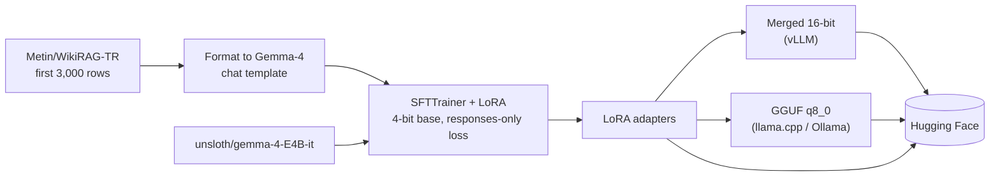

# Turkish Gemma-4 RAG Fine-tune

Fine-tuning **Gemma-4-E4B** for Turkish retrieval-augmented generation: given a Turkish question and a context passage, answer from the context. Trained with Unsloth + LoRA on 3,000 Turkish RAG examples, and published on Hugging Face as LoRA, merged 16-bit and GGUF versions.

- Model: https://huggingface.co/uabali/gemma4-e4b-TR
- Notebook: [`gemma4_e4b_finetune_TR.ipynb`](gemma4_e4b_finetune_TR.ipynb)

## Overview

The goal is a small model that stays faithful to the provided Turkish context. Each training example is a single chat turn:

```text
user:  Soru:\n<question>\n\nBağlam:\n<context>
model: <answer grounded in the context>
```

## Pipeline



## Training setup (from the notebook)

| Setting | Value |
|---|---|
| Base | `unsloth/gemma-4-E4B-it`, loaded in 4-bit |
| Adapted layers | language: attention + MLP (vision layers frozen) |
| LoRA | r = 8, alpha = 8, dropout = 0 |
| Max sequence length | 4096 |
| Batch | 4 per device × 4 gradient accumulation |
| Optimizer / schedule | adamw_8bit, lr 2e-5, cosine, 50 warmup steps, 2 epochs |
| Loss | `train_on_responses_only`: prompt tokens are masked |

## Results

- **0.23%** of parameters trained (LoRA)
- About **42 minutes** of training on one **A100**
- Published as **LoRA, 16-bit and GGUF** versions on Hugging Face

Evaluation coming soon: base vs fine-tuned on a held-out Turkish RAG split (faithfulness / exact match). The current run uses no eval set.

## Quickstart (inference)

```python
from unsloth import FastModel

model, tokenizer = FastModel.from_pretrained(
    model_name="uabali/gemma4-e4b-TR",
    max_seq_length=4096,
    load_in_4bit=True,
)
FastModel.for_inference(model)

messages = [{"role": "user", "content": [{"type": "text",
    "text": "Soru:\n<SORU>\n\nBağlam:\n<BAĞLAM>"}]}]
inputs = tokenizer.apply_chat_template(messages, add_generation_prompt=True,
    tokenize=True, return_dict=True, return_tensors="pt").to("cuda")
print(tokenizer.decode(model.generate(**inputs, max_new_tokens=256)[0]))
```

GGUF builds run with llama.cpp or Ollama.

## Next steps

- Hold out an evaluation split and report base vs fine-tuned scores.
- Add negative examples (context does not contain the answer) to train refusals.

## License

Apache 2.0. See [LICENSE](LICENSE).
